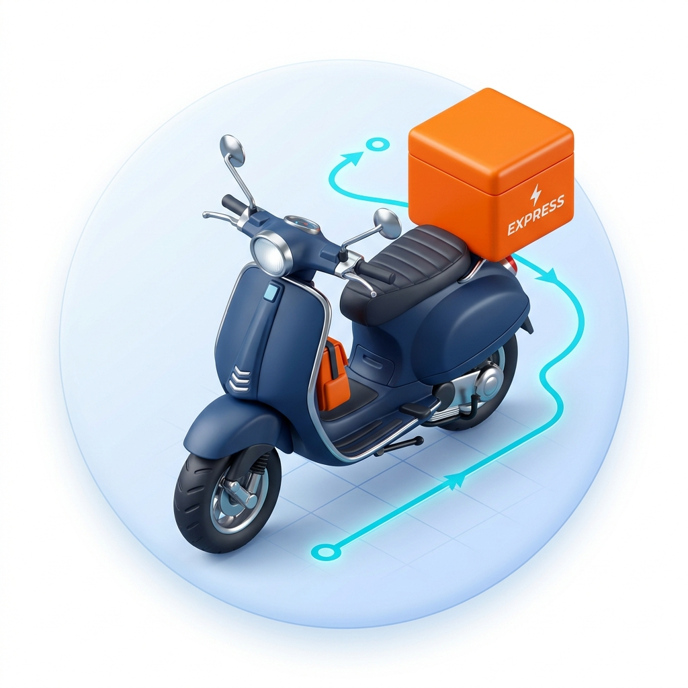
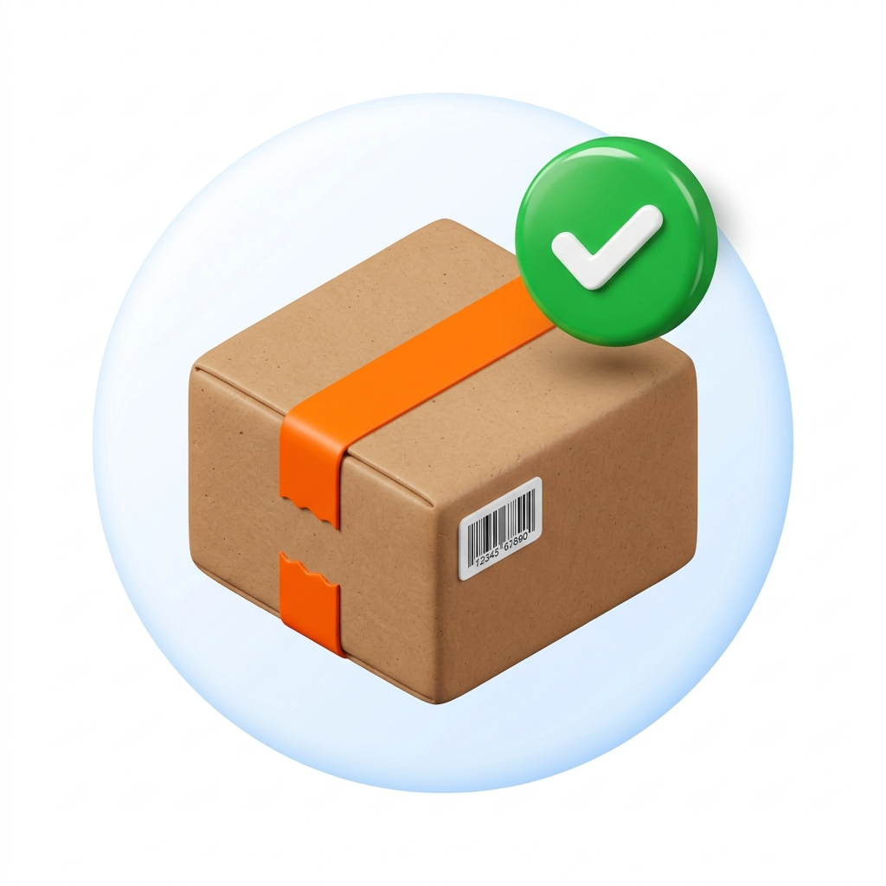
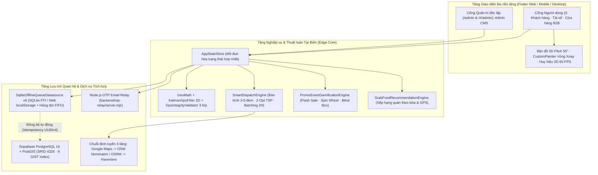
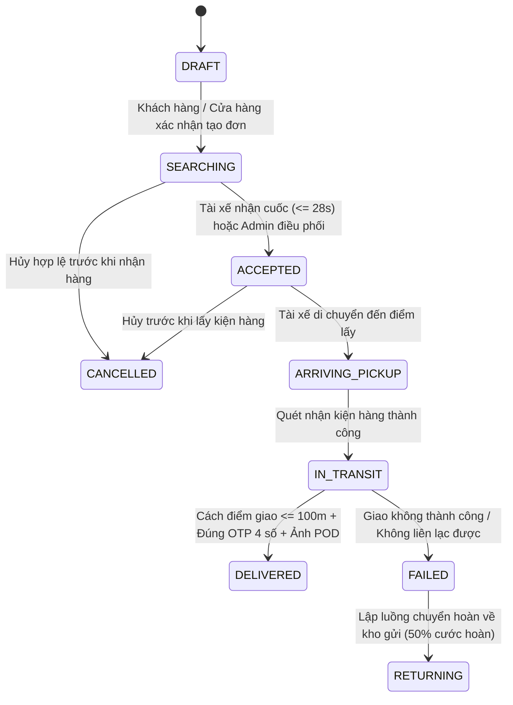

<div align="center">



# GO-MAU Delivery • Giao Hàng Siêu Tốc (GHST)

**Hệ Thống Ứng Dụng Giao Hàng Định Vị GPS Thời Gian Thực & Siêu Ứng Dụng Đa Dịch Vụ Đa Nền Tảng**

[](https://flutter.dev)
[](https://dart.dev)
[](database_schema.sql)
[](gps_delivery_app/lib/data/datasources/local/sqlite_offline_queue_datasource.dart)
[](gps_delivery_app/test/)

[**Tổng quan**](#-1-tổng-quan-dự-án) · [**Hệ sinh thái tính năng**](#-2-hệ-sinh-thái-tính-năng-nổi-bật) · [**4 Phân hệ nghiệp vụ**](#-3-kiến-trúc-4-phân-hệ-người-dùng) · [**Sơ đồ kiến trúc & FSM**](#-4-kiến-trúc-kỹ-thuật--vòng-đời-đơn-hàng) · [**Thuật toán cốt lõi**](#-5-các-thuật-toán-cốt-lõi-tại-tầng-edge) · [**Cài đặt & Chạy ngay**](#-6-hướng-dẫn-cài-đặt--khởi-chạy) · [**Kiểm thử**](#-7-kiểm-thử-tự-động--đảm-bảo-chất-lượng)

</div>

---

## 📌 1. Tổng Quan Dự Án

**GO-MAU Delivery (GHST Express)** là nền tảng giao nhận chặng cuối (*Last-mile Logistics*) kết hợp mô hình siêu ứng dụng (*Super-App*) được phát triển từ một cơ sở mã nguồn **Flutter & Dart** duy nhất cho **Web, Android, iOS và Windows Desktop**.

Hệ thống giải quyết trọn vẹn 5 bài toán cốt lõi của giao vận đô thị mật độ cao tại Việt Nam:
1. **Minh bạch lộ trình & định giá động**: Tự động bóc tách cước theo khoảng cách thực tế, khung giờ cao điểm, thời tiết, vùng hàng rào địa lý (*Geofence*) và mã khuyến mãi.
2. **Chống nhiễu & gian lận tín hiệu GPS**: Kết hợp bộ lọc **Kalman 2D** làm mượt quỹ đạo giữa nhà cao tầng và bộ kiểm định **3 lớp chống Fake GPS**.
3. **Vận hành bền bỉ khi mất mạng (*Offline-First*)**: Lưu trữ cục bộ toàn vẹn bằng SQLite / Web `localStorage` kèm hàng đợi đồng bộ **FIFO Idempotency UUIDv4** lên đám mây **Supabase PostgreSQL + PostGIS** khi có mạng trở lại.
4. **An toàn bàn giao & dòng tiền thu hộ (*COD*)**: Khóa xác nhận giao hàng (**POD**) trong bán kính `<= 100m` kết hợp mã OTP 4 chữ số, tự động hạch toán tỷ lệ **80% Tài xế / 20% Nền tảng** và đối soát công nợ B2B.
5. **Khởi tạo dữ liệu sạch (*Clean-Start Production*)**: Không nạp sẵn tài khoản ảo, số dư giả hay đơn hàng mẫu khi cài mới; tách biệt hoàn toàn cổng người dùng (`/`) và cổng quản trị viên độc lập (`/admin`).

### Thông tin Học thuật & Nhóm phát triển

| Hạng mục | Nội dung chi tiết |
| :--- | :--- |
| **Đơn vị đào tạo** | Viện Công Nghệ Số – Trường Đại học Thủ Dầu Một (TDMU) |
| **Học phần** | Phát triển ứng dụng đa nền tảng |
| **Đề tài** | Xây dựng hệ thống ứng dụng giao hàng định vị GPS thời gian thực đa nền tảng |
| **Giảng viên hướng dẫn** | **Võ Văn Lên** |
| **Nhóm thực hiện (Nhóm 14)** | **Phạm Trí Hiển** · **Nguyễn Phương Nam** · **Nguyễn Minh Nhân** |
| **Quy mô nghiệp vụ** | **4 phân hệ độc lập** · **50+ màn hình** · **46+ Use Case** · **18 bảng CSDL không gian** |

---

## 🚀 2. Hệ Sinh Thái Tính Năng Nổi Bật

Bên cạnh lõi giao nhận GPS chuẩn thương mại, dự án tích hợp các mô hình nghiệp vụ hiện đại lấy cảm hứng từ **Grab, Shopee, Xanh SM và Be**:

| Nhóm tính năng | Mô tả kỹ thuật & Nghiệp vụ thực tế |
| :--- | :--- |
| ⚡ **Đa gói cước & Ghép đơn 2H**<br>*(GrabExpress / Ahamove)* | Hỗ trợ 5 gói vận chuyển: **Hỏa tốc 30 phút**, **Ghép đơn thông minh 2H** (giảm 25% cước nhờ gom các đơn cùng hướng lệch góc `< 38°`), **Tiêu chuẩn 2h**, **Tiết kiệm 4h** và **Xe tải nhẹ / Van**. |
| 🗺️ **Giao Đa Điểm & Khứ Hồi**<br>*(Nearest-Neighbor + 2-Opt TSP)* | Cho phép thêm nhiều điểm trả hàng trên cùng một chuyến, tự động sắp xếp lại thứ tự trạm tối ưu để cắt giảm quãng đường vòng, hỗ trợ **quay lại điểm gửi (2 chiều)** và xác nhận hoàn tất từng trạm. |
| 🍜 **Gợi Ý Ăn Uống Thông Minh**<br>*(GrabFood Discovery & B2B Menu)* | Đề xuất quán ngon quanh vị trí khách theo khung giờ bữa ăn (*Sáng, Trưa, Trà chiều, Tối, Đêm*), tự động gắn nhãn bảo quản lạnh & phụ phí túi giữ nhiệt cho món đá/kem, đồng bộ trực tiếp với trình quản lý thực đơn của Cửa hàng B2B. |
| 🌱 **Giao Hàng Xanh EV & Quỹ Xanh**<br>*(Xanh SM × GrabEco)* | Tùy chọn ưu tiên tài xế **Xe máy điện không khói (EV)** trong thuật toán điều phối, đo lường lượng phát thải $\text{CO}_2$ tiết kiệm được (`95g/km`) và cho phép đóng góp Quỹ Xanh trồng cây. |
| 🎡 **Sự Kiện Săn Sale, Vòng Xoay & Hộp Mù**<br>*(Shopee × Grab Gamification)* | Trung tâm săn thưởng gồm **Điểm danh 7 ngày** nhận `GHST Xu`, **Khung Giờ Vàng Flash Sale** (`00:00 / 09:00 / 12:00 / 18:00 / 21:00`), **Nhiệm vụ GrabChallenges**, **Vòng Xoay May Mắn 8 ô** (`CustomPainter` 100% trúng quà) và **Bàn Gacha 6 Hộp Mù Bí Ẩn** phân hạng `R / SR / SSR` cấp Voucher thật dùng ngay cho cả Ship & GrabFood. |
| 🔗 **Chia Sẻ Hành Trình Trực Tiếp**<br>*(Live Share Tracking + Safety PIN)* | Tạo liên kết theo dõi công khai kèm **mã an toàn 4 chữ số** cho người nhận xem trực tiếp vị trí tài xế, lộ trình nhiều trạm và tiến độ đơn mà không cần đăng nhập tài khoản. |

---

## 🧩 3. Kiến Trúc 4 Phân Hệ Người Dùng

<table>
  <tr>
    <td width="50%" valign="top">
      
      <h4>1. Phân hệ Khách hàng (Customer App)</h4>
      <ul>
        <li>Đăng ký / Đăng nhập mật khẩu, Google OAuth, OTP.</li>
        <li>Sổ địa chỉ GPS & ghim vị trí trực tiếp trên bản đồ.</li>
        <li>Đặt đơn giao hàng đa điểm, đặt món <b>GrabFood</b>, chọn xe điện EV.</li>
        <li>Đấu trường <b>Flash Sale, Vòng Xoay May Mắn & Hộp Mù Gacha</b>.</li>
        <li>Theo dõi xe 3D thời gian thực, Chat nội bộ, gọi ẩn số (<code>0912***678</code>), đánh giá 5 sao & gửi khiếu nại có bằng chứng.</li>
      </ul>
    </td>
    <td width="50%" valign="top">
      
      <h4>2. Phân hệ Tài xế (Driver / Shipper App)</h4>
      <ul>
        <li>Nộp & duyệt hồ sơ pháp lý điện tử (<b>eKYC</b>, biển số, loại xe Xăng / Điện EV / Xe tải).</li>
        <li>Gạt <b>Online</b> có kiểm tra ký quỹ tối thiểu <code>200.000đ</code> và toàn vẹn tín hiệu GPS.</li>
        <li>Nhận cuốc thông minh đếm ngược <code>28 giây</code>, hỗ trợ nhận cuốc nối tiếp & ghép đơn 2H.</li>
        <li>Bản đồ dẫn đường nghiêng 3D <code>55°</code>, khóa xác nhận POD <code>&lt;= 100m</code> + mã OTP 4 số.</li>
        <li>Ví thu nhập tự động chia <code>80/20</code>, quản lý tiền thu hộ COD và biểu đồ hiệu suất.</li>
      </ul>
    </td>
  </tr>
  <tr>
    <td width="50%" valign="top">
      
      <h4>3. Phân hệ Cửa hàng B2B (Merchant Portal)</h4>
      <ul>
        <li>Quản lý hồ sơ doanh nghiệp, cấu hình đa kho lấy hàng GPS & Webhook đồng bộ trạng thái.</li>
        <li>Tạo đơn lẻ hoặc <b>nhập đơn hàng loạt bằng tệp CSV</b> chuẩn RFC-4180 có kiểm lỗi từng dòng.</li>
        <li>Quản lý <b>Thực đơn Ăn uống Đối tác B2B</b> (món nóng/lạnh, giá bán, tồn kho tức thì).</li>
        <li>Kết xuất <b>tem vận đơn nhiệt chuẩn A6</b> tích hợp mã vạch <code>Code-128B</code> và mã QR.</li>
        <li>Đặt lịch xe gom hàng định kỳ, đối soát phiên COD minh bạch và rút tiền về ngân hàng.</li>
      </ul>
    </td>
    <td width="50%" valign="top">
      
      <h4>4. Cổng Quản trị viên (Admin CMS — <code>/admin</code>)</h4>
      <ul>
        <li>Tách biệt hoàn toàn tại đường dẫn <code>/admin</code> (hoặc <code>/#/admin</code>) với luồng <b>Thiết lập Quản trị viên đầu tiên</b>.</li>
        <li>Dashboard KPI toàn sàn, bản đồ giám sát đội xe trực tuyến & nhật ký kiểm toán (Audit Log).</li>
        <li>Duyệt hồ sơ eKYC tài xế, gán/điều phối đơn thủ công và xử lý trọng tài khiếu nại đền bù.</li>
        <li>Cấu hình bảng giá động, vẽ vùng phụ phí đa giác <b>Geofence</b>, phát hành gói <b>Flash Sale Shopee × Grab</b> 1 chạm.</li>
        <li>Ma trận phân quyền <b>RBAC</b> chi tiết theo vai trò và cấu hình nóng kết nối Cloud / API.</li>
      </ul>
    </td>
  </tr>
</table>

---

## 🏗️ 4. Kiến Trúc Kỹ Thuật & Vòng Đời Đơn Hàng

### 4.1. Kiến trúc Offline-First & Đồng bộ Đám mây (Cloud-Optional)



### 4.2. Máy Trạng Thái Hữu Hạn (FSM) 9 Trạng Thái Đơn Hàng



---

## 🧠 5. Các Thuật Toán Cốt Lõi Tại Tầng Edge

1. **Lọc nhiễu tín hiệu vệ tinh Kalman 2D** ([`kalman_gps_filter.dart`](gps_delivery_app/lib/core/gps/kalman_gps_filter.dart))
   - Triệt tiêu hiện tượng nhảy tọa độ do phản xạ đa đường (*Urban Multipath*) dựa trên phương sai dự đoán $P_{k|k-1} = P_{k-1} + \Delta t \cdot q^2$ ($q = 3.0\text{ m/s}$) và hệ số lợi ích Kalman $K_k$. Tự động tái khởi tạo khi tín hiệu ngắt quãng quá `60 giây`.
2. **Kiểm định chống gian lận vị trí 3 lớp & Thích ứng Pin** ([`gps_integrity_validator.dart`](gps_delivery_app/lib/core/gps/gps_integrity_validator.dart))
   - Kiểm tra cờ `isMockFlaggedByOs` của hệ điều hành (`RULE-GEO-01`), chặn bước nhảy vận tốc phi vật lý `> 120 km/h` (`RULE-GEO-02`), đối chiếu chéo gia tốc kế IMU khi di chuyển `> 30 km/h` (`RULE-GEO-03`), và tự động hạ góc nghiêng 3D + giãn chu kỳ ping khi pin dưới `50% / 20% / 10%`.
3. **Điều phối đa trọng số & Tối ưu lộ trình 2-Opt TSP** ([`smart_dispatch_engine.dart`](gps_delivery_app/lib/core/gps/smart_dispatch_engine.dart))
   - Quét mở rộng 3 tầng bán kính (`3km -> 5km -> 8km`), chấm điểm tài xế theo khoảng cách (`50%`), điểm sao (`30%`), tỷ lệ nhận chuyến (`20%`) kèm điểm cộng ưu tiên xe máy điện EV.
   - Giải bài toán giao hàng nhiều điểm dừng bằng khởi tạo **Nearest-Neighbor** kết hợp hoán vị đảo cung **2-Opt** loại bỏ các đoạn đường tự cắt nhau.
4. **Hàng rào địa lý Ray-Casting & Lượng giác WGS84** ([`geo_math.dart`](gps_delivery_app/lib/core/utils/geo_math.dart))
   - Kiểm tra điểm nằm trong vùng đa giác phụ phí/cấm giao ngay trên thiết bị với độ phức tạp $O(N)$, kết hợp công thức Haversine và góc phương vị *Bearing* điều khiển hướng xoay mô hình xe 3D.
5. **Chuẩn mã hóa thanh toán EMVCo VietQR & Vận đơn Code-128B** ([`security_and_barcode_utils.dart`](gps_delivery_app/lib/core/utils/security_and_barcode_utils.dart))
   - Sinh chuỗi TLV chuẩn Napas247 kèm mã kiểm tra dư vòng **CRC-16/CCITT-FALSE** (`0x1021`) và vẽ mã vạch tuyến tính chuẩn `Code-128B` trực tiếp trên tem nhiệt A6.

---

## 📂 6. Cấu Trúc Thư Mục Dự Án

```text
AppGiaoHangGPS_Project/
├── database_schema.sql                       # Lược đồ PostgreSQL 16 + PostGIS (18 bảng, 8 chỉ mục R-Tree GIST)
├── Bao_Cao_Tieu_Luan_Nhom14.docx             # Báo cáo thuyết minh học phần (Nhóm 14 - TDMU)
├── README.md                                 # Tài liệu tổng quan dự án
└── gps_delivery_app/                         # Mã nguồn ứng dụng đa nền tảng Flutter
    ├── assets/icons_3d/                      # Mô hình & biểu tượng 3D Isometric (GLB, BIN, PNG)
    ├── backend/otp-relay/                    # Dịch vụ Node.js gửi Email OTP qua SMTP cho Flutter Web
    ├── database/schema.sql                   # Bản sao lược đồ CSDL đồng bộ cùng gói ứng dụng
    ├── lib/
    │   ├── main.dart                         # Điểm khởi chạy & định tuyến tách biệt (/ và /admin)
    │   ├── core/
    │   │   ├── gps/                          # Kalman 2D, Anti-Fake GPS, Smart Dispatch, 2-Opt, GrabFood Engine
    │   │   ├── promotions/                   # Động cơ Gamification Shopee x Grab, Vòng Xoay & Hộp Mù Gacha
    │   │   ├── services/                     # Dịch vụ xác thực thực tế, Google OAuth & OTP
    │   │   ├── theme/                        # Hệ thống thiết kế Neo-Brutalist & bảng màu thương hiệu
    │   │   └── utils/                        # Toán học địa lý WGS84, định dạng tiền tệ, VietQR CRC-16, Code-128B
    │   ├── domain/                           # Thực thể nghiệp vụ (Entities), Enums & giao diện Repositories
    │   ├── data/
    │   │   ├── datasources/local/            # AppStateStore (5 part-files) & SQLite v8 / Web localStorage Engine
    │   │   ├── datasources/remote/           # Đồng bộ đám mây Supabase PostGIS (EWKT SRID 4326)
    │   │   └── models/                       # Các bản ghi dữ liệu bất biến & tuần tự hóa JSON/SQL
    │   └── presentation/
    │       ├── customer/                     # 14 màn hình Khách hàng + GrabFood + Vòng Xoay & Hộp Mù
    │       ├── driver/                       # 9 màn hình Tài xế + Dẫn đường 3D + POD OTP + Ví 80/20
    │       ├── merchant/                     # 12 màn hình Cửa hàng B2B + CSV Batch + Tem A6 + Thực đơn món
    │       ├── admin/                        # 12 màn hình Quản trị viên CMS + Geofence + RBAC
    │       ├── screens/                      # Cổng điều hướng chính, Cổng Admin & Trang Live Share công khai
    │       └── widgets/                      # Bản đồ tương tác 3D, Huy hiệu 3D 60 FPS & Banner Offline Queue
    └── test/
        ├── clean_start_test.dart             # Kiểm thử khởi tạo sạch, tách biệt /admin & di trú dữ liệu
        ├── competitor_features_test.dart     # Kiểm thử GrabFood, 2-Opt TSP, Xanh EV, Vòng Xoay & Hộp Mù
        ├── widget_test.dart                  # Kiểm thử 22 kịch bản nghiệp vụ liên vai trò & chống tràn 50+ màn hình
        └── fixtures/                         # Dữ liệu mẫu phục vụ riêng cho môi trường kiểm thử tự động
```

---

## ⚡ 7. Hướng Dẫn Cài Đặt & Khởi Chạy

### 7.1. Yêu cầu môi trường
- **Flutter SDK**: `>= 3.13.0` (kèm trình duyệt **Google Chrome** hoặc **Microsoft Edge** nếu chạy bản Web, hoặc Visual Studio C++ workload nếu chạy bản Windows Desktop).
- Không bắt buộc cài đặt PostgreSQL hay khóa API bên ngoài để chạy thử: chế độ **Offline-First** hoạt động đầy đủ 100% tính năng ngay trên máy cục bộ.

### 7.2. Chạy nhanh trên trình duyệt Web (Khuyên dùng)

```powershell
# 1. Di chuyển vào thư mục mã nguồn Flutter
cd gps_delivery_app

# 2. Tải các gói thư viện phụ thuộc
flutter pub get

# 3. Khởi chạy trực tiếp trên Chrome với cổng cố định 8080
flutter run -d chrome --web-port=8080
```

> **Mẹo chạy dưới dạng máy chủ Web nền (`web-server`)**:
> ```powershell
> flutter run -d web-server --web-hostname=localhost --web-port=8080
> ```

Sau khi khởi chạy thành công, mở trình duyệt tại 2 địa chỉ độc lập:
- 📱 **Ứng dụng Khách hàng / Tài xế / Cửa hàng B2B**: `http://localhost:8080/`
- 🛡️ **Cổng Quản trị viên (Admin CMS)**: `http://localhost:8080/admin` *(hoặc `http://localhost:8080/#/admin` — lần đầu truy cập sẽ mở màn hình **Thiết lập quản trị viên đầu tiên**)*

### 7.3. Cấu hình nâng cao (Tùy chọn: Supabase PostGIS & Gmail OTP Relay)

<details>
<summary><b>Nhấn để xem hướng dẫn kết nối Cloud Supabase PostGIS & Dịch vụ gửi Email OTP thật</b></summary>

#### A. Khởi tạo CSDL không gian trên Supabase / PostgreSQL 16
1. Tạo dự án mới trên Supabase (hoặc PostgreSQL 16 cục bộ có bật tiện ích mở rộng `postgis` và `uuid-ossp`).
2. Mở **SQL Editor** và thực thi toàn bộ nội dung tệp [`database_schema.sql`](database_schema.sql).

#### B. Chạy dịch vụ Node.js gửi Email OTP cho Flutter Web (`backend/otp-relay`)
```powershell
cd gps_delivery_app/backend/otp-relay
npm install
Copy-Item .env.example .env
# Điền SMTP_USER, SMTP_PASS (Gmail App Password 16 ký tự), RELAY_TOKEN vào tệp .env
npm start
```

#### C. Khởi chạy Flutter kèm biến môi trường `--dart-define`
```powershell
cd gps_delivery_app
flutter run -d chrome --web-port=8080 `
  --dart-define=SUPABASE_URL=https://your-project.supabase.co `
  --dart-define=SUPABASE_ANON_KEY=your-anon-key `
  --dart-define=OTP_EMAIL_WEBHOOK_URL=http://127.0.0.1:8787/otp-email `
  --dart-define=OTP_EMAIL_WEBHOOK_TOKEN=your-relay-token
```

</details>

---

## 🧪 8. Kiểm Thử Tự Động & Đảm Bảo Chất Lượng

Dự án duy trì tiêu chuẩn **0 lỗi phân tích tĩnh** và **30/30 kịch bản kiểm thử tự động đạt 100%**:

```powershell
cd gps_delivery_app

# Phân tích mã nguồn tĩnh theo chuẩn flutter_lints 6.0
flutter analyze

# Chạy toàn bộ 30 kịch bản kiểm thử đơn vị, nghiệp vụ liên vai trò & giao diện đa khung hình
flutter test --reporter compact

# Biên dịch bản phát hành Web Production
flutter build web
```

| Bộ kiểm thử | Nội dung xác minh trọng tâm |
| :--- | :--- |
| [`clean_start_test.dart`](gps_delivery_app/test/clean_start_test.dart) | Đảm bảo CSDL khởi tạo mới sạch 100% (0 đơn ảo, 0 số dư mẫu), tách biệt hoàn toàn vai trò người dùng với cổng `/admin`, và bảo toàn dữ liệu thật qua cơ chế di trú `remove_demo_v1`. |
| [`competitor_features_test.dart`](gps_delivery_app/test/competitor_features_test.dart) | Kiểm thử chuyên sâu định tuyến đa điểm `2-Opt TSP`, ghép đơn `2H`, ưu tiên xe điện `EV` & giảm phát thải $\text{CO}_2$, gợi ý ăn uống `GrabFood`, cùng toàn bộ luồng **Flash Sale, Điểm danh 7 ngày, Vòng Xoay May Mắn & Hộp Mù Gacha**. |
| [`widget_test.dart`](gps_delivery_app/test/widget_test.dart) | Kiểm toán 22 bộ quy tắc nghiệp vụ (Kalman 2D, chống Fake GPS, ký quỹ `200k`, chia doanh thu `80/20`, khóa bán kính POD `100m`, đối soát COD, CSV RFC-4180, PostGIS EWKT) và quét chống tràn giao diện (`RenderFlex = 0`) trên toàn bộ **50+ màn hình** từ Mobile `360x800` đến Desktop `1920x1080`. |

---

<div align="center">

Phát triển bởi **Nhóm 14 – Viện Công Nghệ Số, Trường Đại học Thủ Dầu Một**  
*Phạm Trí Hiển · Nguyễn Phương Nam · Nguyễn Minh Nhân*

</div>
